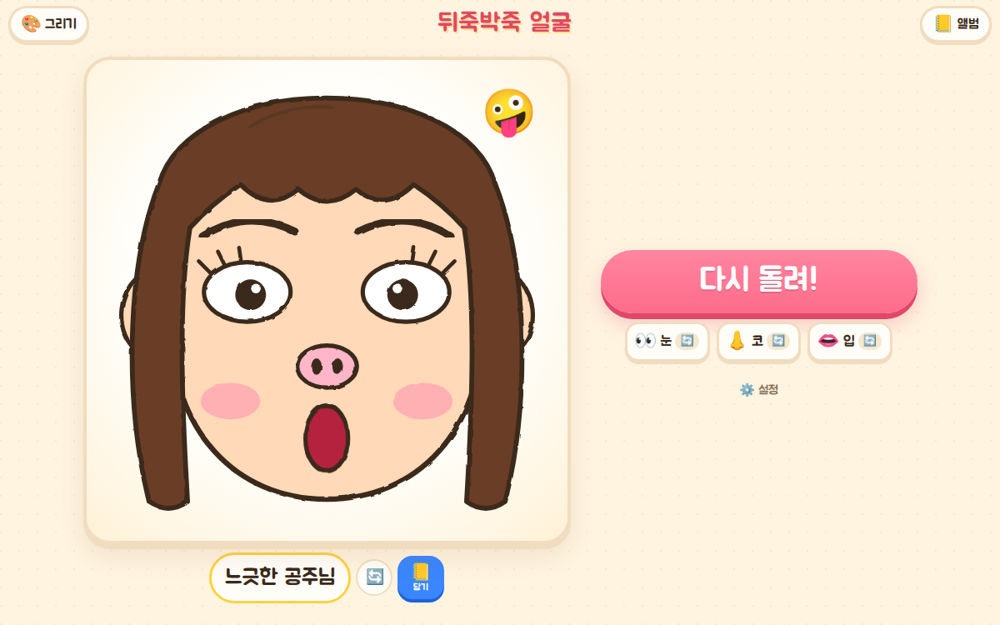
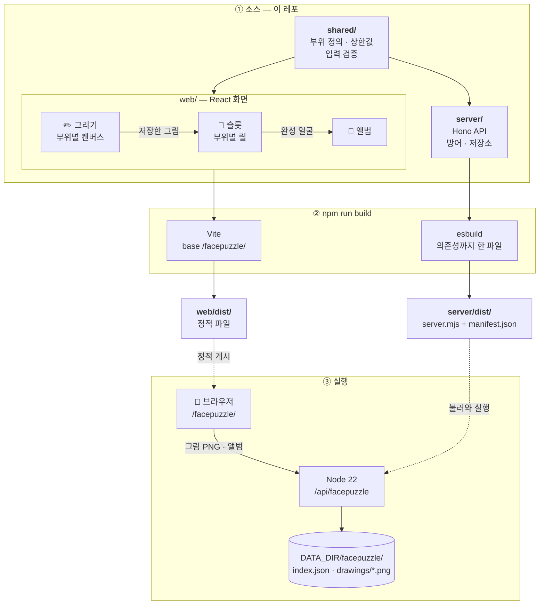

# 뒤죽박죽 얼굴 슬롯

아이가 눈·코·입을 여러 개 그려 두고, 맨 얼굴에서 부위를 하나씩 슬롯머신처럼 돌려 멈추면
웃긴 얼굴 하나가 완성되는 그림 놀이. 휴대폰 세로 화면에 맞췄고, PC에서는 두 칸으로 넓게 보인다.



## 이런 걸 할 수 있다

- 부위를 골라 크게 확대된 칸에 그리기. 흐린 얼굴과 점선 가이드가 어디에 그리면 되는지 알려 준다
- 모든 부위에 [🪞 거울 모드] / [✏️ 일반 모드]가 있다
  - 눈·귀·눈썹: 거울 모드는 한쪽만 크게 그리면 반대쪽이 거울처럼 똑같이 붙는다.
    일반 모드는 두 눈(두 눈썹)이 한 캔버스에 나와 마음대로 그리고, 귀는 캔버스 양옆 [◀ 왼쪽]/[오른쪽 ▶]으로 번갈아 그린다
  - 얼굴·코·입·머리: 거울 모드면 가운데 줄 기준으로 양쪽이 같이 그려진다
- 크레용은 자주 쓰는 6색이 늘 보이고, 🌈 를 누르면 색 고르기 창이 열린다. 무지개 판을 누르거나 문질러서 아무 색이나,
  아래 회색 막대로 흰색~검은색을 고르고 [✔ 이 색으로 그리기]. 만든 색은 '내가 만든 색'에 6개까지 남는다
- [저장]하면 칸이 비워져서 바로 다음 그림을 그린다. 그림은 계속 늘어난다
- 그리는 중에 [나] 옆 작은 얼굴(🔍)을 누르면 전체 얼굴에 지금 그림을 붙여 크게 보여 준다.
  [🔀 다른 얼굴]은 다른 부위를 슬롯 후보 중 아무거나로 바꿔 내 그림을 대 본다
- 그리기 화면 맨 위 줄은 부위 탭만 있다. 슬롯으로 가는 [🎰 슬롯]은 맨 아래 '저장한 그림' 줄 앞에 있다
- 슬롯은 맨 얼굴에서 시작한다. 빈자리에는 점선 윤곽과 ? 가 통통 튄다
  - 부위 줄의 버튼(또는 얼굴의 그 자리)을 누르면 그 부위만 돌고, 한 번 더 누르면 멈춘다. 다 채우면 이름이 붙는다
  - 부위 줄에는 그 릴에 든 그림이 썸네일로 나란히 보인다(이 중에서 나온다). 도는 동안 불빛이 지금 칸을 따라가고,
    멈추면 뽑힌 그림에 ⭐ 가 붙는다. 줄 끝 [✏️ 그리기]를 누르면 그 부위를 바로 그리러 간다
  - [🎰 모두 돌려!]는 한꺼번에 돌리고 [✋ 모두 멈춰!]는 머리부터 차례로 딱딱 멈춘다. [🧼 맨 얼굴]은 처음부터
  - 그리기·앨범에 다녀와도 만들던 얼굴은 그대로 있다
- 폰 세로 화면: 얼굴은 화면 폭을 꽉 채우고, 부위 줄은 그 아래 칸에서 위아래로 민다. [모두 돌려!]는 늘 맨 아래.
  그리기 화면의 부위 탭은 옆으로 넘기지 않고 탭 수만큼 칸을 나눠 한 줄에 다 보인다(심화 7칸).
  옆으로 넘기는 줄(썸네일·그린 그림)은 손가락으로 밀거나 PC 에서는 마우스로 끌어서 넘긴다
- 완성되면 얼굴이 입을 움직이며 자기 이름을 말하고(읽어주기), 반응 이모지가 튀어나온다.
  평소에는 눈을 깜빡이며 두리번거리고, 안 도는 부위를 누르면 간지럼 타듯 흔들린다
- 기본 단계는 눈·코·입, 심화 단계는 얼굴·귀·머리·눈썹까지 돈다
- 그린 사람(나·엄마·아빠…)을 고를 수 있고, 돌아간 부위가 모두 한 사람 그림이면 잭팟!
- 완성 얼굴은 랜덤 별명과 함께 앨범에 담고, 이미지로 저장·공유한다
- 처음부터 예시 그림이 들어 있어서 그리기 전에도 돌려 볼 수 있다 (기본 얼굴은 긴 머리)
  - ⚙️ 설정에서 [예시 그림도 섞기]를 끄면 가족이 그린 그림만 나온다. 얼굴에 붙어 있던 예시도 떼어지고,
    아직 안 그린 부위는 빈 줄에 [✏️ 그리러 가기]만 남는다(그 부위는 빼고 얼굴이 완성된다)
- 지운 그림은 30일 동안 휴지통에서 되살릴 수 있다
- 단계(기본/심화)·예시 그림 섞기·소리·읽어주기는 슬롯 화면 아래 ⚙️ 설정에 모았다

## 구조와 빌드



1. **소스**: 화면(`web/`, React)과 그림을 저장하는 작은 서버(`server/`, Hono)가 한 레포에 있다.
   부위마다 그리는 영역·그림 크기·상한값은 `shared/`에 두고 둘이 같이 쓴다.
2. **빌드**: `npm run build` 하나로 화면은 Vite가 `web/dist/`로, 서버는 esbuild가 의존성까지 묶어 `server/dist/server.mjs` 한 파일로 만든다.
3. **실행**: 브라우저는 `/facepuzzle/`의 정적 파일을 받고, 그린 그림(PNG)과 앨범은 같은 도메인의 `/api/facepuzzle`로 보낸다.
   서버는 `DATA_DIR/facepuzzle/`에 목록(`index.json`)과 그림 파일을 쌓아서 가족 기기끼리 같은 그림을 본다.

키 없이 열려 있는 대신 서버가 과도한 입력을 막는다 (크기·형식 검사, IP별·전체 속도 제한, 저장 할당량).

```bash
npm run setup   # web·server 의존성 설치 (Node 22)
npm run dev     # server :8080 + web :5173 → http://localhost:5173/facepuzzle/
npm test && npm run lint && npm run build
```

---

개발 문서: [docs/development.md](docs/development.md)
